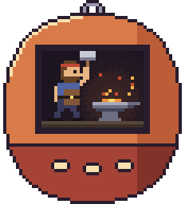

# Forgotchi

A tiny 8-bit desktop pet for macOS. A blacksmith hammers hot iron while [Claude Code](https://claude.com/claude-code) is working, and stands still when it's idle.



## How it works

Claude Code hooks run `hook.sh`, which keeps one file per busy session in `/tmp/claude-tama`. The app checks that folder 12 times a second. While any session is busy he hammers; when none are, he rests.

- **He starts** when you send a prompt and keeps going through tool calls.
- **He stops** when Claude finishes, hits an API error, waits for your permission or input, or the session ends.

## Install with a prompt

Paste this into Claude Code:

```text
Install Forgotchi (https://github.com/pratikaman/forgotchi) on this Mac:

1. Clone the repo to ~/forgotchi and run ./build.sh there. It needs the Xcode Command Line Tools;
   if swiftc is missing, tell me to run `xcode-select --install` and stop.
2. Back up my Claude Code user settings (~/.claude/settings.json, plus $CLAUDE_CONFIG_DIR/settings.json
   if I use another config dir). Then ADD these hooks alongside any hooks already there. Never replace
   or remove existing hooks. Each command is ~/forgotchi/hook.sh followed by one argument:
   - UserPromptSubmit                 -> ~/forgotchi/hook.sh work
   - PreToolUse, matcher "*"          -> ~/forgotchi/hook.sh work
   - PostToolUse, matcher "*"         -> ~/forgotchi/hook.sh work
   - Stop                             -> ~/forgotchi/hook.sh idle
   - StopFailure                      -> ~/forgotchi/hook.sh idle
   - SessionEnd                       -> ~/forgotchi/hook.sh idle
   - Notification, matcher "permission_prompt|idle_prompt|elicitation_dialog" -> ~/forgotchi/hook.sh idle
3. Check that the settings file is still valid JSON, then run: open ~/forgotchi/Forgotchi.app
```

He should start hammering on your next prompt. If he doesn't, restart Claude Code so it picks up the new hooks.

## Manual install

```sh
git clone https://github.com/pratikaman/forgotchi ~/forgotchi
cd ~/forgotchi && ./build.sh && open Forgotchi.app
```

Then merge this into `~/.claude/settings.json`, keeping any hooks you already have:

```json
{
  "hooks": {
    "UserPromptSubmit": [{ "hooks": [{ "type": "command", "command": "~/forgotchi/hook.sh work" }] }],
    "PreToolUse": [{ "matcher": "*", "hooks": [{ "type": "command", "command": "~/forgotchi/hook.sh work" }] }],
    "PostToolUse": [{ "matcher": "*", "hooks": [{ "type": "command", "command": "~/forgotchi/hook.sh work" }] }],
    "Stop": [{ "hooks": [{ "type": "command", "command": "~/forgotchi/hook.sh idle" }] }],
    "StopFailure": [{ "hooks": [{ "type": "command", "command": "~/forgotchi/hook.sh idle" }] }],
    "SessionEnd": [{ "hooks": [{ "type": "command", "command": "~/forgotchi/hook.sh idle" }] }],
    "Notification": [{ "matcher": "permission_prompt|idle_prompt|elicitation_dialog", "hooks": [{ "type": "command", "command": "~/forgotchi/hook.sh idle" }] }]
  }
}
```

## Using it

- Drag him anywhere on screen. He remembers the spot.
- Right-click → **Quit Forgotchi**.
- To start him at login, add `Forgotchi.app` under System Settings → General → Login Items.

## Uninstall

Paste into Claude Code:

```text
Remove every hook whose command contains forgotchi/hook.sh from my Claude Code settings, quit Forgotchi, and delete ~/forgotchi.
```

## Notes

- Requires macOS 14 or later.
- Claude Code has no hook for pressing Esc. After an interrupt he keeps hammering until Claude's "waiting for your input" notification fires.
- Activity older than 30 minutes is ignored, so a crashed session can't leave him hammering forever. A single command that runs longer than that pauses him early.
